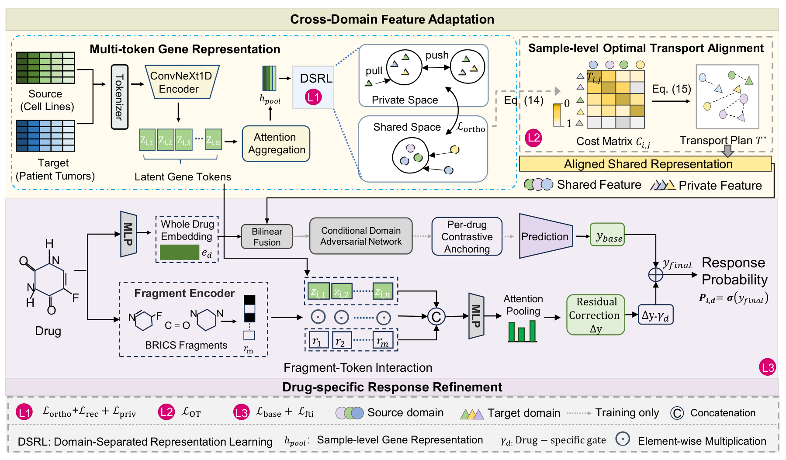

# AdaDRP

Source code for **AdaDRP**, a cross-domain adaptation framework for drug response prediction (cell lines → patient tumors).

Reliable drug response prediction is of great value for precision oncology. However, cross-domain prediction from cell lines to patient tumors faces significant challenges due to substantial distribution shifts. Existing methods mainly rely on global adversarial alignment between cell lines and patient tumors, which may suppress signals specific to each domain and leave drug-specific response patterns insufficiently modeled. To address these issues, we propose **AdaDRP**, an adaptation framework for cross-domain drug response prediction. AdaDRP represents each gene expression profile as multiple latent gene tokens and separates transferable response signals from variation specific to each domain. Rather than forcing source and target samples into a single adversarially aligned distribution with less discriminative information, AdaDRP uses optimal transport to build soft correspondences at the sample level in the shared space. To make the transferred representation responsive to each drug, molecular fragments interact with gene tokens and produce residual response signals that refine the base prediction. A contrastive constraint at the drug level further reduces semantic interference across drugs. Experiments across nine drugs show that AdaDRP consistently outperforms competitive baselines, demonstrating the benefit of optimal transport alignment and drug-tailored response refinement for cross-domain drug response prediction.

## Framework



(Vector version: [框架图.pdf](框架图.pdf))

## Method Overview

AdaDRP consists of two cooperating parts:

**Cross-Domain Feature Adaptation** (`adadrp/models.py`, `adadrp/ot_utils.py`, `adadrp/stage1_program.py`)
- **Multi-token gene representation**: each gene expression profile is tokenized and encoded by a ConvNeXt1D encoder into latent gene tokens, which are aggregated into a sample-level gene representation `h_pool`.
- **Domain-Separated Representation Learning (DSRL)**: shared/private subspaces decompose transferable response signals from domain-specific variation, regularized by orthogonality, reconstruction, and private-domain losses.
- **Sample-level Optimal Transport alignment**: a cost matrix between source and target samples yields a transport plan that builds soft sample-level correspondences in the shared space, instead of collapsing both domains into one adversarially aligned distribution. A conditional domain adversarial network (CDAN) is applied on the fused representation for domain conditioning.

**Drug-Specific Response Refinement** (`adadrp/fpi.py`, `adadrp/fragment_encoder.py`, `adadrp/stage2_program.py`)
- A whole-drug embedding is fused with `h_pool` by bilinear fusion to produce a **base prediction** `y_base`.
- **Fragment-Token Interaction (FTI)**: BRICS molecular fragments are encoded and interact with the latent gene tokens; attention pooling produces a **residual correction** `Δy`, which is gated by a drug-specific gate `γ_d` and added to the base prediction: `y_final = y_base + γ_d · Δy`.
- **Per-drug contrastive anchoring** enforces a drug-level contrastive constraint that reduces semantic interference across drugs.

Training runs in three stages (`train_adadrp_program.py` with 5-fold cross-validation): Stage 1 pretrains the tissue classifier; Stage 2 trains the fusion model with OT alignment, CDAN, DSRL, and FTI; Stage 3 performs contrastive domain isolation (top-K).

## Requirements

The code is verified under the `macb_drp` conda environment:

| Package      | Version    |
|--------------|------------|
| Python       | 3.11       |
| PyTorch      | 2.4.1+cu118 |
| numpy        | 1.26.4     |
| pandas       | 2.2.2      |
| scikit-learn | 1.6.1      |
| scipy        | 1.13.1     |
| RDKit        | 2026.03.1  |

```bash
conda create -n macb_drp python=3.11
conda activate macb_drp
pip install torch==2.4.1 --index-url https://download.pytorch.org/whl/cu118
pip install numpy==1.26.4 pandas==2.2.2 scikit-learn==1.6.1 scipy==1.13.1 rdkit
```

Alternatively, `requirements.txt` contains the full pinned environment export.

## Data

1. Download the datasets from [Google Drive](https://drive.google.com/file/d/1azKGGPOCJNDP4vQbV1v8p_XqCrd7ekP1/view?usp=sharing) and place them under `data/`.
2. Expected layout:

```
data/
├── raw_dat/                  # raw CCLE / GDSC / TCGA data
├── preprocessed/             # preprocessed features
│   ├── 1000gene_features.csv
│   ├── gdsc_ic50.csv
│   ├── gdsc_ic50flag.csv
│   ├── cosmic_gexpr38_ID.csv
│   └── gene_names.txt
├── TCGA_labels.csv           # patient tumor labels
├── gdsc_tcga_drug_mapping.csv
├── drug_fragments_brics_m16_fp1024.npz   # BRICS drug fragments
└── gene_set_mask.pt          # gene-set mask
```

3. If needed, regenerate the derived files:

```bash
python scripts/precompute_drug_fragments.py   # -> data/drug_fragments_brics_m16_fp1024.npz
python scripts/build_gene_set_mask.py         # -> data/gene_set_mask.pt
```

## Training and Evaluation

Quick start (default configuration):

```bash
python train_adadrp_program.py --train --n 5
```

Full configuration used to produce the paper results:

```bash
python train_adadrp_program.py \
  --measurement Z_SCORE --thres_gdsc 0.0 --thres_label 0.1 --n 5 --train \
  --backbone_type convnext1d --convnext_depth 1 --convnext_kernel_size 7 \
  --num_programs 8 --program_dim 64 --K 3 \
  --use_ot_alignment --lambda_ot 0.005 --ot_reg 0.1 \
  --ot_cost_type cosine --ot_marginal_type uniform \
  --use_cdan \
  --use_domain_sep --domain_sep_hidden_dim 256 --domain_sep_output_dim 64 \
  --lambda_ortho 0.001 --lambda_recon 0.005 --lambda_private_domain 0.005 \
  --lambda_migrate 0.01 \
  --alph 1.4 --beta 0.066 \
  --use_fpi --fpi_gamma_max 0.1 --fpi_gamma_init 0.05 --fpi_q_prior_weight 0.01 \
  --fpi_dropout 0.1 --fpi_m_max 16 --fpi_fp_dim 1024 \
  --lambda_fpi_gamma_l1 0.001 --fpi_detach_mode none \
  --pretrain_num_epochs 100 --train_num_epochs 100 --contrastive_num_epochs 100
```

Outputs:
- `logs/<timestamp>adadrp_program/` — checkpoints and logs for each fold
- `results/fold-{0..4}/<param_str>_adadrp.csv` — per-fold, per-drug metrics
- `outputs/adadrp_step2_results.csv` — aggregated 5-fold metrics

### Main Results (5-fold cross-validation)

| Drug | AUC | AUPR |
|------|------|------|
| 5-Fluorouracil   | 0.6308 | 0.7268 |
| Cisplatin        | 0.6524 | 0.8352 |
| Cyclophosphamide | 0.6873 | 0.9548 |
| Docetaxel        | 0.5479 | 0.7325 |
| Doxorubicin      | 0.6023 | 0.8409 |
| Etoposide        | 0.7378 | 0.9135 |
| Gemcitabine      | 0.5777 | 0.5871 |
| Paclitaxel       | 0.5551 | 0.7350 |
| Temozolomide     | 0.6067 | 0.4395 |
| **Mean ± std**   | **0.6220 ± 0.0755** | **0.7517 ± 0.1585** |

## Unseen-Drug (Zero-Shot) Prediction

See [experiments/unseen_drugs/README.md](experiments/unseen_drugs/README.md). Run training with `--use_unseen_drugs --unseen_drugs_config <config.json>` to hold out drugs for zero-shot evaluation.

## Ablation and Sweeps

- `run_ablation.sh` — module-wise ablation (w/o OT, w/o DSRL, w/o FTI, etc.)
- `run_topk_sweep.py` / `scripts/run_k_sweep.sh` — contrastive top-K sweep
- `run_hyperparam_tuning.py` — hyper-parameter search
- `scripts/` — preprocessing, diagnostic, and visualization utilities

## Project Structure

```
├── adadrp/                    # AdaDRP core package
│   ├── backbones.py           # ConvNeXt1D / MLP / ResNet token backbones
│   ├── models.py              # token encoder, classifiers, fusion, domain separation
│   ├── fpi.py                 # Fragment-Token Interaction (gated residual refinement)
│   ├── fragment_encoder.py    # BRICS fragment encoder
│   ├── fragment_utils.py      # fragment loading utilities
│   ├── ot_utils.py            # sample-level optimal transport
│   ├── losses.py              # auxiliary losses
│   ├── stage1_program.py      # Stage 1: tissue classifier pretraining + features
│   └── stage2_program.py      # Stage 2&3: fusion training + contrastive isolation
├── train_adadrp_program.py    # main entry (3-stage training, 5-fold CV)
├── dataload.py / config.py    # data loading and path configuration
├── scripts/                   # preprocessing and analysis utilities
├── experiments/unseen_drugs/  # zero-shot unseen-drug experiments
├── data/                      # datasets
├── logs/ results/ outputs/    # logs, per-fold results, aggregated metrics
└── framework.png              # framework figure
```

## Citation

```bibtex
% TODO: replace with the published reference
@inproceedings{adadrp,
  title   = {AdaDRP: Cross-Domain Drug Response Prediction via Sample-Level Optimal Transport and Drug-Tailored Response Refinement},
  author  = {},
  year    = {2026}
}
```
